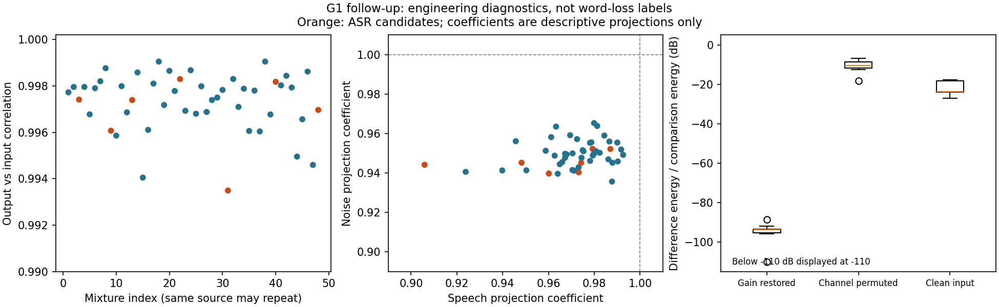

# G1 问题核查与阶段决策

日期：2026-11-11。承接[G1首轮诊断报告](G1_首轮诊断报告.md)。本阶段回答：推理流程是否有明显错误、7条ASR退步是否得到试听支持、当前是否值得开发恢复模块。

> 后续已完成的频谱与空间原因实验、8条新语句确认及新的改进方向，见[G2阶段报告](G2_原因分析与改进方向.md)。本文件保留当时“不进入吞字恢复”的决策与原始试听反馈。

## 结论与决定

**暂不进入“吞字恢复模块”设计。** 7条ASR退步候选和6条正常对照的用户辅助试听，均未报告明显人声退步；其中`JUST`虽然被ASR漏掉，用户明确反馈带噪和增强均能听清。当前没有足够证据支持“McNet在本批场景中稳定误删人声”这一研究前提。

更明确的现象是：**这批自建场景中，McNet输出与带噪输入很接近，声音指标收益较小。** 流程核对暂未发现能解释这一现象的通道读取、归一化或解码错误；噪声空间场与原实验的差异值得继续排查，但还不是已证明的原因。

本阶段的问题核查和“是否进入方法设计”的决策已完成，决定是**不通过方法设计门槛**。这不代表项目失败，也不证明McNet在其他场景绝不吞字。没有启动训练、修改网络或为展示失败而另挑一批音频。

## 1. 核对了什么，实际发现什么

48条原混合全部进行输入/输出分析；另在探测前冻结13个混合（7条候选＋每位说话人首条正常对照），每个做4种输入检查，共52次短音频前向。13个混合来自12条源语句，不能计作13条独立语句。

| 检查 | 实际结果 | 能支持的结论 |
|---|---|---|
| 权重及构造配置 | 固定官方权重严格加载；checkpoint所记录的模块顺序、邻频范围、上下文等参数按值一致 | 未发现构造参数与已保存超参数冲突；未声称复现完整官方测试集 |
| 原始特征独立计算 | 52次实虚交错顺序及参考幅度归一化最大差值0 | 这些输入上的特征排列和归一化一致 |
| 独立cIRM反解公式 | 与适配器重建最大采样差约5.96×10⁻⁷ | 未发现掩码反解或重复幅度恢复错误 |
| 调用官方`prepare_time_domain` | 仅将Torch2的ISTFT输入转为complex，52次输出与适配器最大差0 | 当前兼容适配未引入额外解码差异 |
| 复跑原混合 | 13条与之前保存输出逐采样一致 | 原结果可复现，不是换了权重或输出文件 |
| 全局时移 | 48条在±16ms搜索内的最大互相关均位于0采样点 | 未发现此范围内的整体时移；不证明每个音素没有局部变化 |
| 公共幅度缩小至1/4 | 恢复幅度后，与原输出差异能量比最差仍约−88.63dB | 本次范围内不支持把整体输入响度当成小收益的主要解释 |
| 非参考麦顺序置换 | 保持第5麦不变，其他通道倒序后，输出差异能量比中位数约−10.42dB | 模型对其他声道输入有响应；不能据此量化多通道增益或称为消融成绩 |
| 只输入重建干净声场 | 13次与参考的差异能量比中位数约−23.77dB | 网络并非对干净语音完全恒等；这些数值不能自动判定吞字 |

置换和干净输入是工程探测，不是新算法或新的独立测试集。干净声场由原源文件、原分数延时和公共比例重建；参考麦与原PCM24参考之差受量化精度约束。未修改原输入/输出文件，也未将延时或增益拟合结果用于原质量指标。

探测首版因直接比较Python的tuple与list而提前中止；复核确认`(3,2)`与`[3,2]`等仅类型不同，按序列数值一致。已在v2记录原类型与比较结果，完成全部探测。`g1_followup_v1/`保留停止记录，不能把它当成配置失配的模型结果。

## 2. 为什么说当前更像“抑制幅度有限”

48条输出与带噪参考麦的相关系数中位数为**0.99776**；输出RMS相对输入平均只降低约**0.312dB**，差异信号的能量相对输入中位数约**−22.44dB**。这些和原先SI-SDR平均仅提升0.130dB的结果一致。

进一步用已知干净参考`s`、参考麦噪声`n=x−s`对输出做描述性回归：

`output ≈ a × s + b × n + residual`

语音系数中位数约**0.9737**，噪声系数中位数约**0.9493**。这说明输出中仍有较强的、与原噪声相关的成分，支持“当前抑制有限”这一现象描述。**a、b不是网络内部真实分离出的语音/噪声增益，不用于证明局部词音保留或删除。** 多个混合共享源语句，未做总体发生率、显著性或泛化结论。



图中橙色为ASR候选，蓝色为其他样本。最右图的三类比较具有不同用途，不能按箱线高低选择增强方法；低于−110dB的值仅在图上显示为−110dB，JSON原数值保留。

## 3. 试听反馈及其边界

你先反馈`JUST`在两路中均能听清，又反馈其余6条候选没有明显退步，最后补听6条正常对照也没有明显退步。三个原始回答及对应样本ID分别保存在[listening_feedback.json](../artifacts/g1_followup_v2/listening_feedback.json)和[control_feedback.json](../artifacts/g1_followup_v2/control_feedback.json)。

- 试听覆盖13/48个混合、12/24条源语句、全部6位说话人；包含7/7条ASR退步候选和6条预先选定的正常对照。
- 反馈结论是“未报告明显听感退步”。不是13条的逐词完整性标注，也不是对剩余35个混合的判断。
- 这是知道任务背景的单人辅助试听，未做随机盲听、独立听写、听者间一致性或音素对齐；不能写成已经证明人类可懂度提高。
- ASR仍有7条退步，其原始结果全部保留。没有为了符合试听而修改识别文本、归一化规则或WER。

因此，当前可以排除“这7条ASR退步自动等于7例人声损失”的推断；不能进一步声称所有识别差异均已找到具体原因。

## 4. 已验证事实、可能原因与未知项

**已验证：**官方解码一致、当前输出可复现、输入响度缩放影响很小、输出依赖非参考声道、这批输出改动较小、13条试听没有被报告为明显变差。

**值得验证的假设：**单个DEMAND通道被重传播为一个定向声源，与原实验使用的实录多通道背景噪声具有不同的空间统计特征，可能影响预训练模型的抑制行为。噪声类型、录音内容、固定方向、语料与阵列近似也同时不同，**本阶段没有隔离这些变量，不能认定空间域偏移就是唯一或主要原因**。

论文3.1节说明实验采用CHiME-3模拟数据，语音由单通道延时构造、无混响，背景噪声来自四类场景的多麦录音。因此“当前没有混响”本身不是已成立的训练域差异。来源：[McNet原论文](https://arxiv.org/pdf/2211.08872)。官方配置虽含`reverb_proportion`，固定版本`TrainDataset.__getitem__`并未据此传入RIR，不能仅看这个字段就声称实际施加了混响，见[本地官方代码](../third_party/McNet/src/dataset/train_dataset.py)。

**仍未知：**小收益的具体因果机制、实录空间噪声中的表现、其他语句/噪声/方向下是否有可复核的内容损失，以及真正改进模型的收益与训练成本。

## 5. 下一阶段建议与资源边界

推荐继续保留McNet，下一阶段先做**预先规定的小规模噪声空间条件诊断**，而不是进入恢复模块开发。可以固定语音、阵列、SNR等主要因素，对单定向与物理一致的多方向噪声场作对照；若参考噪声波形也随生成方式改变，应重复固定随机种子并明确这一混杂，不能包装成完全单变量因果实验。

仍保持一个ASR、几十个短混合、无训练的规模。不要把其他阵列录制的六路噪声直接拼到当前坐标上并称为匹配阵列，也不要把多个新噪声片段称为多个独立噪声录音。若后续真的发现稳定声学问题，再冻结失效定义、使用新语句确认，并比较最接近已有方法；否则保留负结果并调整研究问题。

**本轮没有新增语句确认批。** 原约定为“问题成立才确认”；目前尚无得到支持的具体声学失效，贸然建立“确认集”会暗示已存在待确认的问题。没有新增依赖、下载新语音库、训练、修改官方模型、变更驱动/CUDA或创建新环境。现有4060 8GB足够完成本次短输入探测，训练可行性仍未验证。

## 6. 复核入口

- 原结果与全体分母：[G1首轮报告](G1_首轮诊断报告.md)。
- 数值探测：[summary.json](../artifacts/g1_followup_v2/summary.json)、[probes.jsonl](../artifacts/g1_followup_v2/probes.jsonl)、[冻结方案](../artifacts/g1_followup_v2/frozen_plan.json)。
- 7条候选的识别差异和反馈：[candidate_reviews.json](../artifacts/g1_followup_v2/delivery/candidate_reviews.json)。
- 最终决策：[decision.json](../artifacts/g1_followup_v2/delivery/decision.json)。旧`decision/`目录是仅收到7条候选反馈时的中间快照，最终以`delivery/`为准；正常对照试听页仍保留在该旧目录。
- 新增4项解析检验，连同此前40项，**44项全部通过**；原G1的40项历史日志不改写。日志与本阶段交付审计位于`artifacts/g1_followup_v2/verification/`及`delivery/completion_audit.json`。

主要WSL命令如下。输出目录已存在，脚本拒绝覆盖；仅用于追溯，不要求重新执行。

```bash
.venv/bin/python scripts/probe_baseline_behavior.py --output-dir artifacts/g1_followup_v2
.venv/bin/python scripts/summarize_followup.py --probe-dir artifacts/g1_followup_v2 --feedback artifacts/g1_followup_v2/listening_feedback.json --control-feedback artifacts/g1_followup_v2/control_feedback.json --output-dir artifacts/g1_followup_v2/delivery
.venv/bin/python -B -m unittest discover -s tests -v
```

本阶段停在问题核查与路线决策；后续噪声空间条件实验尚未执行。
