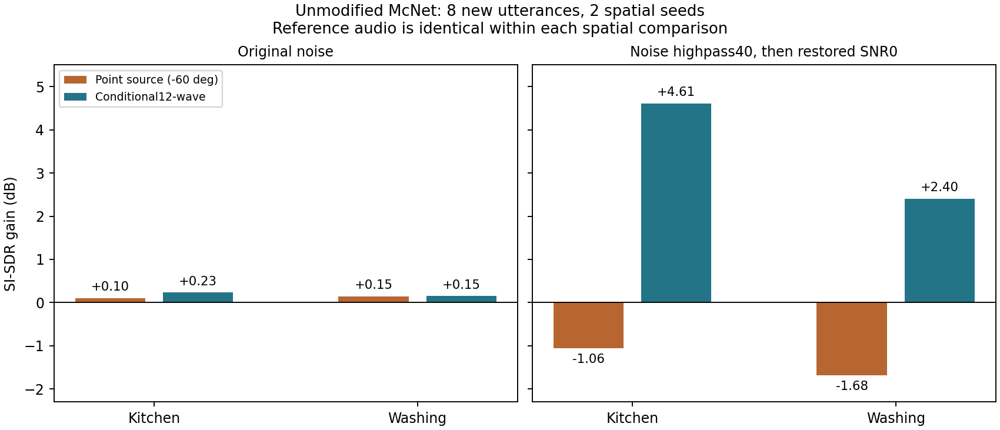

# G2 原因分析与改进方向

记录日期：2026-11-11。本文件承接[G1阶段决策](G1_问题核查与阶段决策.md)。

> 阶段完成：发现集对照及8条新语句确认已完成，改进方向已选定。这里确认的是当前模拟条件中的失效与研究方向，尚未实现或验证改进模型。

**最终选择：保留McNet，研究“空间噪声条件覆盖驱动的轻量适配与语音保真”。不开发预设的吞字恢复模块，也不把高通或LoRA本身当成创新。**

## 1. 已找到的两层原因

**第一层是诊断场景的频谱/SNR问题。** 原DEMAND洗衣机和厨房录音均有约16.383Hz的强分量，整段录音低于20Hz的能量占比分别约98.68%、81.70%。首轮按全频活动SNR混合，因此标为0/5dB，不等于语音频段也处于低SNR。首轮100Hz—8kHz整句带内SNR中位数分别约30.92dB、15.21dB，这与原本较高的STOI及试听未发现明显吞字相符。

固定40Hz高通对照进一步验证了数值偏差：发现集原噪声条件下，带噪参考麦SI-SDR均值约−0.98dB，单独高通后约18.62dB，而PESQ从2.175降到2.129。大幅SI-SDR变化不能直接解释成人声内容改善。这是标准DSP对照，不是本项目创新；也没有证据将低频成分的来源认定为设备故障或数据损坏。

新语句上重复了同一现象：原噪声参考麦SI-SDR约−0.652dB，高通后18.703dB；PESQ约2.137→2.128。之前只用全频SNR判断噪声难度的方式存在偏差，后续必须同时登记频谱和带内SNR。16.383Hz的波长约20.94m，而本阵列最大孔径约0.276m，单平面波跨阵列的相位差上界仅约4.74°；这是解释低频空间差异弱的物理辅助分析，不是对网络内部机制的直接观测。

**第二层是当前模型在自建阵列声场中的空间条件敏感性。** 先移除噪声中低于40Hz的强成分，再将噪声恢复到活动SNR=0dB，使语音频段真正面临噪声挑战。固定同一语音、目标声场和第5麦带噪波形，只改变其他声道的噪声场，模型性能出现明显差异。

| 发现集：每格6条源语句 | 原−60°定向噪声 ΔSI-SDR | 12波空间场 ΔSI-SDR | 两者差值 |
|---|---:|---:|---:|
| 厨房，噪声高通后重新混到0dB | −0.748dB | +5.620dB | +6.368dB |
| 洗衣机，同上 | −1.818dB | +2.102dB | +3.920dB |

这两个空间条件的参考麦波形逐采样完全相同，差异不能用参考麦音质或SNR变化解释。原始未处理噪声下，相应SI-SDR差值只有约0.130/0.039dB，低频能量主导掩盖了更明显的空间条件差异。

入射角对照也很重要：保持高相干点声源，改为+60°时，洗衣机/厨房平均ΔSI-SDR约+1.064/+1.631dB，优于原−60°。因此不能把退化简单归因于“所有相干噪声都处理不好”。目前最准确的表述是：**在当前近似阵列下，模型对噪声的空间结构与入射方向存在敏感性，原先选到的−60°定向条件较不利。**

以上是受控输入干预支持的现象解释。尚不能分离网络内部具体机制、近似几何与原训练声场的全部差异，也不能外推为真实录音中的普遍因果规律。

**假设演进没有隐藏：**最早“只改空间场、保留原噪声”实验没有通过预设的强SI-SDR效应门槛。保留该负结果后，频谱检查才引出后续频谱×空间假设；新假设及确认规则在8条新语句评价前冻结，未改动旧结果以迎合结论。

## 2. 实验设计与当前证据

- 48条空间发现实验：6条旧源语句×2段噪声×4种空间条件。
- 48条频谱×空间实验：同6条语句×2噪声×原始/高通噪声×点声源/12波场；高通噪声均重新标定为0dB。
- 48条角度补充实验：同6条语句，噪声高通后，在−60°、+60°、目标同向点声源及12波场比较。同向条件存在空间可分性限制，不作为“应当全部解决”的承诺。
- 固定高通的前处理、后处理和无网络对照；目标始终是未滤波的原干净参考，未通过滤波目标美化成绩。
- 一个固定Whisper tiny.en评价三路语音。发现集中，处理后的洗衣机点声源场景WER由50%升至80%，但厨房点声源场景由51.67%降至41.67%，说明声音指标与识别并非同向，不能只用SI-SDR选择方法。每格只有60个参考词，此处不作总体显著性结论。

12波场是满足固定参考波形约束的条件有限平面波叠加，物理上可表示为多个延时声源之和；它不是实录声场，也不是精确弥散噪声。其余声道的相位、幅度与时间统计均可能改变，因此因果结论针对“空间噪声条件整体”，不只针对单一相干系数。

确认使用8条新完整语句、6位原说话人、两段原噪声的新片段、两个空间随机种子，128/128条推理、声音指标与三路ASR均完成。新语句ID/文件哈希与原24条不重合，新噪声片段避开原片段及其他新语句片段，并留0.25秒间隔。流式读取官方归档43,028,480字节，只保存所需8条语句，未下载完整大型语料。

| 新语句确认：每格8条源语句 | 空间随机种子 | 12波场相对原定向场的ΔSI-SDR | 正差语句 |
|---|---:|---:|---:|
| 厨房，高通噪声重新混到0dB | 0 | +5.640dB | 8/8 |
| 厨房，同上 | 1 | +5.683dB | 8/8 |
| 洗衣机，同上 | 0 | +4.134dB | 8/8 |
| 洗衣机，同上 | 1 | +4.035dB | 8/8 |

四个切片全部通过预设规则：均值正差且至少6/8语句正差。参考麦逐采样一致，不进行延时或增益拟合。两个种子是空间场生成种子，不是两次训练，也不是新增独立语句。G2合计14条不同源语句（6条发现、8条确认）、272个条件混合，不是272条独立语句；确认范围为活动全频SNR=0dB、名义阵列及当前目标方向。6位说话人与两段原噪声均未完全留出，结论不包含未见说话人或未见噪声类型泛化。

**内容指标仍存在分歧。** 新语句原−60°定向条件下，厨房/洗衣机McNet平均ΔSI-SDR约−1.055/−1.685dB，STOI约下降0.0412/0.0572，WER分别48.0%→56.0%、73.33%→82.67%。12波场的厨房WER改善，但洗衣机两个种子分别73.33%→62.67%和73.33%→81.33%，即SI-SDR改善并不保证ASR改善。每个切片只有8条语句、75个参考词；没有新的人工逐词判定，不能把这些ASR删除称为已经确认的吞字。

进一步给处理后的点声源输入加同一个40Hz高通，也没有解决问题：新语句上，无网络高通参考麦SI-SDR约−0.432dB，先高通再McNet约−1.735dB。由此可区分“原场景的低频评测偏差”和“真正低带内SNR下的空间条件退化”，不将二者混成一个问题。

## 3. 已选方向：空间条件覆盖驱动的轻量适配与语音保真

建议论文题目：**《面向空间噪声条件变化的多通道语音增强轻量适配与语音保真研究》**。确认结果支持采用这一工作方向；题目不宣称已经提出有效新算法。

继续采用官方六通道离线McNet。暂不采用吞字恢复、生成式回填或大模型路线；当前更可检验的问题是：能否用少量新增参数改善不利定向噪声条件，并控制原有效场景和干净语音的退化。

下一阶段采用的具体方案：

1. **数据覆盖先修正。** 同时记录全频SNR与100Hz—8kHz带内SNR，避免次声能量制造“低SNR但语音频段很干净”的假象。适配数据覆盖不同噪声方向与不同相干程度，按“方向×空间结构”分层抽样，包含有效低相干场景及干净/高SNR语音；所有对照使用相同数据池。训练时使用普通物理噪声场叠加，不把本次为固定参考设计的条件化生成器当作真实噪声。
2. **只给McNet前两个空间模块的输出线性层增加标准低秩残差。** 候选位置为`freq.fc_output_layer`、`narr.fc_output_layer`，采用`W'=W+BA`；原权重冻结、B零初始化，先从rank=4开始。两矩阵分别为64×256和64×512，候选新增参数3584个，约为本checkpoint参数量的0.108%。这只说明参数量，不证明训练显存或效果。
3. **保留语音作为明确约束。** 使用原cIRM监督损失；加入干净六通道语音输入的参考麦重建约束，并保留低相干场景的监督回放。目标是避免只针对困难定向噪声适配而损伤原有效条件。它不保证音素或语义完整，仍需WER、STOI和试听检验；不使用原模型在退化场景中的输出作为伪干净标签。

40Hz高通是必须报告的工程对照，其收益不能记到适配器名下。是否作为共同部署前端，应由后续验证选择，不能在只对新方法使用滤波的情况下宣称方法更优。

## 4. 创新边界与必须对比的方法

LoRA、域适配、数据增强、干净语音约束都已有相关研究，不能因组合在McNet上就认定创新。本项目候选增量是：针对本机确认的空间条件退化，检验**空间条件分层覆盖＋局部空间模块适配＋保真约束**是否比普通适配更有效、代价是否值得。若只有普通微调就能解决，应如实降低方法创新主张。

| 相关工作 | 已验证的机制/事实 | 对本项目的约束 |
|---|---|---|
| LoRA: Low-Rank Adaptation of Large Language Models，ICLR 2022 | 官方Microsoft/LoRA提供`loralib`，MIT，支持Linear | 重用标准组件；“增加LoRA”本身不算创新。无McNet适配权重 |
| Learning Noise Adapters for Incremental Speech Enhancement，IEEE SPL 2024 | 冻结模型、领域适配器、噪声选择器 | 适配器和领域选择均是已有方法；本轮未核实可直接用的官方代码/权重 |
| Towards Lightweight Adaptation of Speech Enhancement Models in Real-World Environments，ICASSP 2026 | 单通道GRU/DPRNN的自监督低秩适配；会议信息经作者实验室页面核实 | 低秩语音增强适配已有正式研究；本项目不是该论文完整复现 |
| Microphone Array Generalization for Multichannel Narrowband Deep Speech Enhancement，Interspeech 2021 | 阵列及幅度增强，讨论理想弥散噪声局限 | 空间泛化与多样化训练已有研究 |
| DeFTAN-AA: Array Geometry Agnostic Multichannel Speech Enhancement，Interspeech 2024 | 结构层面的阵列泛化 | 更换整个网络不是当前资源下的首选；未把未核实权重当作可用替代 |

最小方法实验应包括：原McNet；固定高通对照；同数据池、同位置、同rank的**普通LoRA适配（均匀抽样、原监督损失）**；候选完整方案。必要消融分别去掉空间分层与保真约束；若要主张空间模块位置的优势，还需相近参数量的谱模块适配对照。先单次小预算探测，有趋势再扩展，不一次全量重训。普通LoRA是已有机制在McNet上的受控适配，不冒称复现了2026论文的网络、数据或原成绩。

只有优于普通LoRA及合理DSP对照、同时语音保真与原有效条件代价受控，才支持有限的方法增量。只优于原McNet，最多说明适配有用。

因此研究工作包含已完成的频谱混杂诊断和空间条件确认，以及尚待验证的低成本适配增量。不能保证3584个参数足以解决问题，也不能保证该组合具有发表价值；若普通LoRA同样有效、额外约束无收益，应报告消融负结果并将成果定位为实证研究。

## 5. 资源、交付与待完成事项

方法阶段计划仍控制在单卡8GB：先测1秒、batch1的前向/反向资源，必要时累积梯度；网络混合精度与STFT/loss精度分开核对。空间适配仍需梯度经过冻结网络，**少量可训练参数不意味着低激活显存**。本轮不安装LoRA依赖、不实现适配器、不训练，不保证8GB已能训练。

先进行一次小预算趋势探测，再决定是否扩大数据和训练。适配训练、验证、最终测试必须重新按源语句和说话人划分，排除当前全部诊断/确认语句；不能把当前8条确认语句改名为最终测试集。最终还需留出方向、噪声片段，若声称未见噪声类型则另留类型。

本阶段已完成原因分析、确认与方向选择。下一阶段才测训练资源、冻结训练/验证/最终测试清单并实现最小适配；本轮没有新方法实现或训练。新增语句不再作为最终独立测试。

53项测试已通过，涵盖既有IO与泄漏约束、条件平面波的固定参考、空间相干性、40Hz滤波及频谱能量的已知答案。交付审计另核对实际文件、配对分母和数据隔离，不以测试数量代替研究结论。

精度补记：初次DSP记录对写出前Float64结果计分，保存的FLOAT WAV为Float32，出现最高约2.53×10⁻⁷dB的SI-SDR舍入差。已保留旧记录，另对实际文件补评，主报告DSP分数以`saved_audio_scores/`为准；未来脚本先回读保存文件再计分，没有改变音频或重跑模型。

## 来源与详细记录

- [噪声频谱审计](../artifacts/g2_spatial_v1/noise_spectrum_audit.json)、[首轮带内SNR](../artifacts/g2_spatial_v1/speech_band_snr_audit.json)。
- [发现集频谱×空间结果](../artifacts/g2_factorial_v1/analysis_asr/summary.json)、[固定DSP对照](../artifacts/g2_factorial_v1/filter_controls/saved_audio_scores/summary.json)、[角度对照](../artifacts/g2_angle_v1/analysis/summary.json)。
- [确认方案](../configs/g2_confirmation_plan.json)、[生成阶段补充约束](../configs/g2_confirmation_render_plan.json)、[文献核查记录](../configs/g2_literature_evidence.json)。
- [新语句确认全体结果](../artifacts/g2_confirmation_v1/analysis_asr/summary.json)、[确认集DSP对照](../artifacts/g2_confirmation_v1/filter_controls/saved_audio_scores/summary.json)、[全部128条试听与原始识别文本](../artifacts/g2_confirmation_v1/review_v2/index.html)。试听页和CSV的人工标签均为未核查，不沿用旧G1的13条反馈。
- [已选方向的机器可读规格](../configs/improvement_direction.json)、[本阶段交付审计](../artifacts/g2_verification/completion_audit.json)。
- [LoRA原论文](https://openreview.net/forum?id=nZeVKeeFYf9)、[官方实现及许可](https://github.com/microsoft/LoRA)。
- [LNA作者稿](https://www.cedric-richard.fr/Articles/yang2024learning.pdf)，DOI `10.1109/LSP.2024.3482171`。
- [2026轻量适配论文](https://arxiv.org/abs/2603.07471)、[作者实验室会议记录](https://sensors.ini.ch/publications)，DOI `10.1109/ICASSP55912.2026.11462756`。
- [2021阵列泛化论文](https://arxiv.org/abs/2107.12601)、[DeFTAN-AA正式论文](https://www.isca-archive.org/interspeech_2024/lee24g_interspeech.pdf)。
