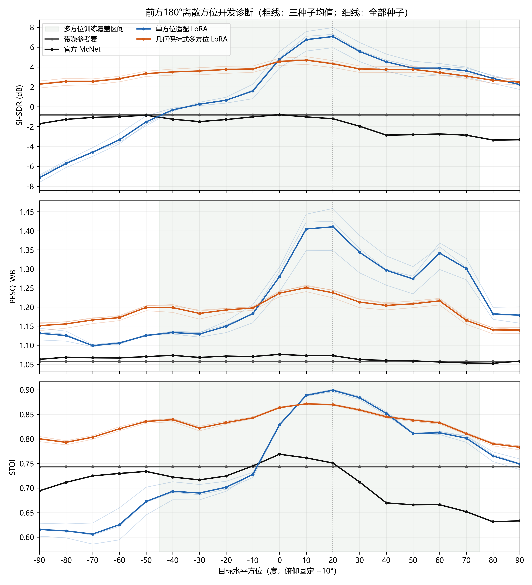
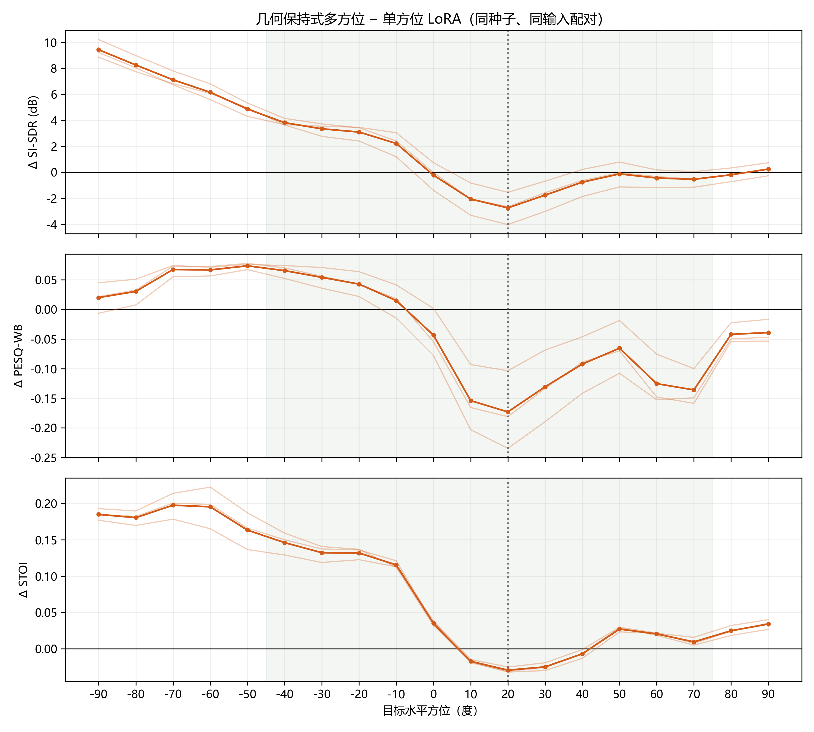

# G35C 19角三项信号指标与方向权衡报告

用户补充批准A通过后执行B/C，优先交三项曲线。A已通过；B1064输入与C8512行信号评分完整，含7448增强输出。无训练、ASR或G34恢复。

8句/4人旧G17开发来源，19角、两噪声、三场型。带噪主比较与干净控制分开；全部三个种子，所有不利记录保留。每角48基础条件、每人两句且各条件等量，等权聚合等价于先话人/句子/条件再种子平均。

|系统|指标|19角均值|最差(角)|最好(角)|波动范围|区间内均值|区间外均值|
|---|---|---:|---|---|---:|---:|---:|
|带噪参考麦|si_sdr_db|-0.8131|-0.8131 (-90,-80,-70,-60,-50,-40,-30,-20,-10,0,10,20,30,40,50,60,70,80,90)|-0.8131 (-90,-80,-70,-60,-50,-40,-30,-20,-10,0,10,20,30,40,50,60,70,80,90)|0.0000|-0.8131|-0.8131|
|带噪参考麦|pesq_wb|1.0571|1.0571 (-90,-80,-70,-60,-50,-40,-30,-20,-10,0,10,20,30,40,50,60,70,80,90)|1.0571 (-90,-80,-70,-60,-50,-40,-30,-20,-10,0,10,20,30,40,50,60,70,80,90)|0.0000|1.0571|1.0571|
|带噪参考麦|stoi|0.7434|0.7434 (-90,-80,-70,-60,-50,-40,-30,-20,-10,0,10,20,30,40,50,60,70,80,90)|0.7434 (-90,-80,-70,-60,-50,-40,-30,-20,-10,0,10,20,30,40,50,60,70,80,90)|0.0000|0.7434|0.7434|
|官方 McNet|si_sdr_db|-1.7819|-3.3481 (80)|-0.7957 (0)|2.5525|-1.7742|-1.7950|
|官方 McNet|pesq_wb|1.0652|1.0524 (80)|1.0758 (0)|0.0234|1.0661|1.0636|
|官方 McNet|stoi|0.7061|0.6313 (80)|0.7689 (0)|0.1376|0.7130|0.6941|
|单方位适配 LoRA|si_sdr_db|1.3227|-7.1527 (-90)|7.0708 (20)|14.2234|3.5267|-2.4557|
|单方位适配 LoRA|pesq_wb|1.2206|1.0987 (-70)|1.4104 (20)|0.3117|1.2704|1.1353|
|单方位适配 LoRA|stoi|0.7494|0.6062 (-70)|0.8993 (20)|0.2931|0.7993|0.6639|
|几何保持式多方位 LoRA|si_sdr_db|3.4108|2.2736 (-90)|4.6950 (10)|2.4214|3.8446|2.6671|
|几何保持式多方位 LoRA|pesq_wb|1.1909|1.1396 (90)|1.2508 (10)|0.1112|1.2086|1.1606|
|几何保持式多方位 LoRA|stoi|0.8293|0.7831 (90)|0.8717 (10)|0.0886|0.8442|0.8038|

区间内12点（−40至+70），外7点；全体按19点等权。表为平均曲线最差值，逐种子最差值另存；不能把曲线更平等同更好，也不能外推连续、360°、三维或真实阵列。

当前只评价信号质量和干净保真，不提供新WER或人工听评结论。未做按话人bootstrap，本报告不作显著性主张。原始逐例与按噪声/场型/种子的分组CSV完整保存。

## 产物与验证

[完整逐例信号](../artifacts/g35_azimuth_scan_v1/signals.jsonl)、[19点数据](../artifacts/g35_azimuth_scan_v1/curves/mean_19_angles.csv)、[逐种子数据](../artifacts/g35_azimuth_scan_v1/curves/per_seed_19_angles.csv)、[噪声场型分组](../artifacts/g35_azimuth_scan_v1/curves/noise_field_groups.csv)、[全部配对差](../artifacts/g35_azimuth_scan_v1/curves/all_paired_differences.csv)、[干净控制](../artifacts/g35_azimuth_scan_v1/curves/clean_controls.csv)。

新共同尺度及显式TF32许可与旧G17口径不同，不用跨轮分差宣称方法收益；所有模型在本轮共用同一输入、参考及尺度。不得根据本开发成绩自动重训或择固定方向。

完成后停止，ASR及后续训练仍需另行批准。
