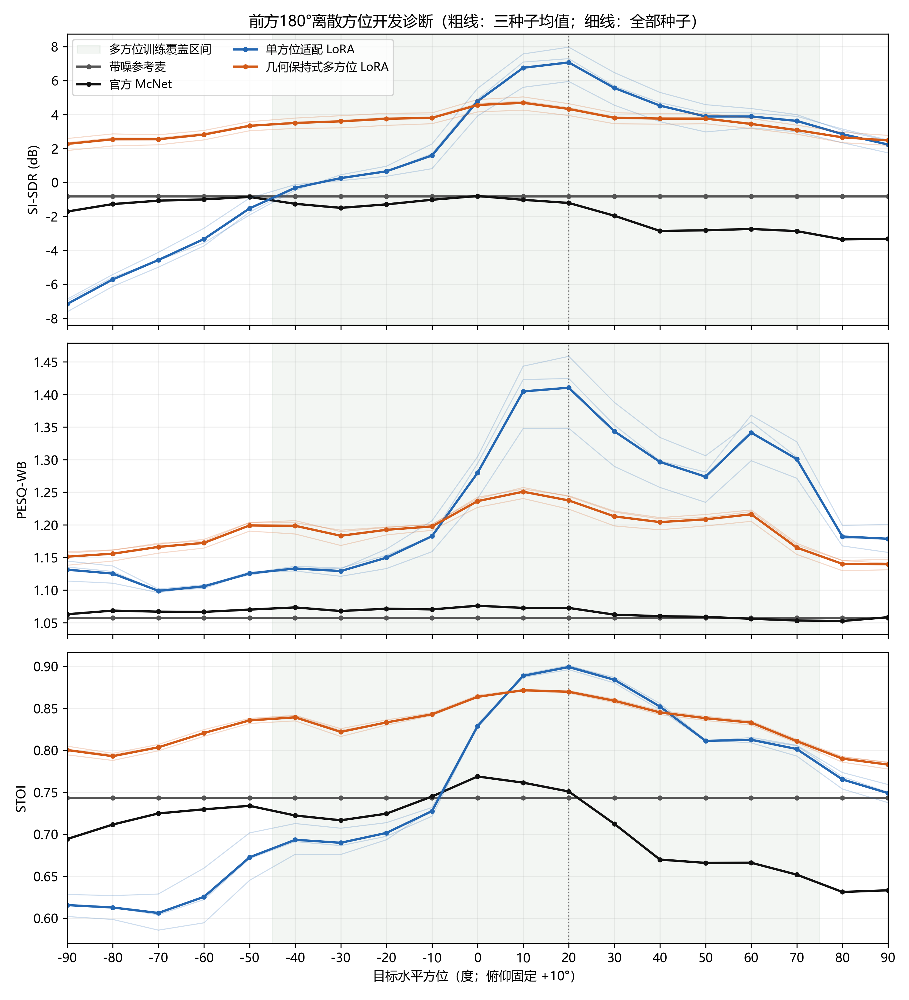
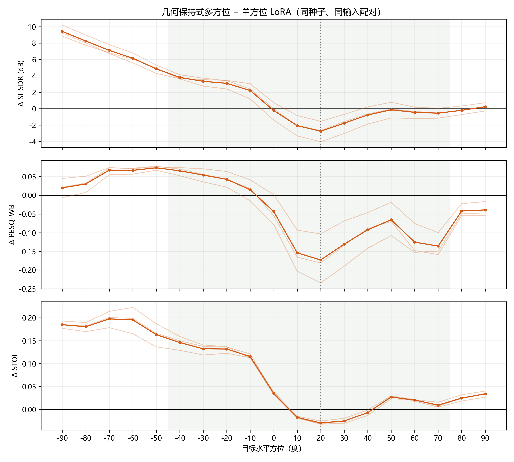

# G35 准入及19角信号扫描交付报告

2026-11-13。按用户补充授权：A通过后执行B、C，优先输出19角SI-SDR、PESQ、STOI曲线。本轮全部完成，无训练、ASR、G34恢复或Git提交。

## A 准入：实际通过及失败

109项记录全部通过，失败0项；七模型×两条旧G17输入=14次前向，墙时48.597秒。
原主干3328706参数，LoRA新增3584（总3332290）；四个低秩矩阵形状为[4,256]/[64,4]和[4,512]/[64,4]。七模型主干摘要完全一致，推理前后参数摘要不变。
点积最大误差4.441e-16，相对角最大误差2.842e-14°，独立TDOA误差0.000e+00样本，FIR所需保护44≤64。容差未放宽。
A阶段Torch峰值分配1.595 GiB，峰值保留2.963 GiB。FP32、TF32两许可关闭；单通道同长、有限、FLOAT保存回读均通过。

[A完整检查表](G35A_几何与模型准入报告.md)、[参数/来源/逐次耗时及显存](../artifacts/g35_admission_v1/result.json)。A报告是在A边界记载未执行B/C，本交付记录用户追加授权后的B/C完成状态，保留原报告。

## B/C 完成范围

B：1064输入（912带噪、152干净），56配对组，耗时97.50秒；所有组自然参考一致，未复制/替换通道，保存后活动SNR误差全部≤0.002dB。
C：7448增强输出、8512行信号指标，耗时1088.97秒；全部八系统、19点、三个种子完整。绘图10.97秒。C峰值分配/保留1.595/2.965 GiB。

|系统|指标|19角平均|最差值/角|最好值/角|极差|
|---|---|---:|---|---|---:|
|带噪参考麦|si_sdr_db|-0.8131|-0.8131 / -90,-80,-70,-60,-50,-40,-30,-20,-10,0,10,20,30,40,50,60,70,80,90°|-0.8131 / -90,-80,-70,-60,-50,-40,-30,-20,-10,0,10,20,30,40,50,60,70,80,90°|0.0000|
|带噪参考麦|pesq_wb|1.0571|1.0571 / -90,-80,-70,-60,-50,-40,-30,-20,-10,0,10,20,30,40,50,60,70,80,90°|1.0571 / -90,-80,-70,-60,-50,-40,-30,-20,-10,0,10,20,30,40,50,60,70,80,90°|0.0000|
|带噪参考麦|stoi|0.7434|0.7434 / -90,-80,-70,-60,-50,-40,-30,-20,-10,0,10,20,30,40,50,60,70,80,90°|0.7434 / -90,-80,-70,-60,-50,-40,-30,-20,-10,0,10,20,30,40,50,60,70,80,90°|0.0000|
|官方McNet|si_sdr_db|-1.7819|-3.3481 / 80°|-0.7957 / 0°|2.5525|
|官方McNet|pesq_wb|1.0652|1.0524 / 80°|1.0758 / 0°|0.0234|
|官方McNet|stoi|0.7061|0.6313 / 80°|0.7689 / 0°|0.1376|
|单方位LoRA|si_sdr_db|1.3227|-7.1527 / -90°|7.0708 / 20°|14.2234|
|单方位LoRA|pesq_wb|1.2206|1.0987 / -70°|1.4104 / 20°|0.3117|
|单方位LoRA|stoi|0.7494|0.6062 / -70°|0.8993 / 20°|0.2931|
|几何保持式多方位LoRA|si_sdr_db|3.4108|2.2736 / -90°|4.6950 / 10°|2.4214|
|几何保持式多方位LoRA|pesq_wb|1.1909|1.1396 / 90°|1.2508 / 10°|0.1112|
|几何保持式多方位LoRA|stoi|0.8293|0.7831 / 90°|0.8717 / 10°|0.0886|

## 当前开发结果读回

几何保持式多方位LoRA相对单方位的19角平均SI-SDR约提高2.088dB（1.323→3.411），平均曲线最差值从−7.153提升至2.274dB，角间极差从14.223缩至2.421dB；平均STOI由0.749升至0.829。不过平均PESQ由1.221降至1.191，不能称所有指标都更好。

历史优势+20°仍有代价：单方位SI-SDR为7.071dB，多方位为4.331dB，约下降2.740dB。多方位本轮最高点为+10°，这只是固定开发协议中19点之一，不据此选择新训练锚点或宣称全局最佳。

图中“粗线/细线的三种子”指两类LoRA；官方McNet和带噪参考各仅一个系统。浅色带表示多方位训练覆盖区间，+20°竖虚线表示历史锚点，连接线不表示连续角度保证。所有原图及矢量导出均已检查可读。

## 解释边界与数据完整性

这是旧G17八句/四人的开发画像，不是新的独立最终确认，也不是连续角度、360°、三维或真实阵列证明。不同指标可有不同排序，不根据曲线自动改训练方位/采样/模型。区间内12点、外7点，完整分组和所有种子均保留。
独立重算平均曲线与CSV最大差1.332e-15；输入、目标、全部输出SHA均复核。历史关键源码/协议和七份权重未变；新数据/产物约2.421GiB，未超10GiB。没有用有限检查或平均曲线代替全覆盖验证。
[19角数据与主报告](G35C_19角三项信号指标与方向权衡报告.md)、[完整交付核验](../artifacts/g35_azimuth_scan_v1/DELIVERY_AUDIT.json)、[干净NMSE/RMS保真](../artifacts/g35_azimuth_scan_v1/curves/clean_fidelity_independent.csv)。

## 安全保存当前版本建议（未执行）

根项目仍无首次Git提交。先经批准在另一个日期命名目录只追加备份，明确路径/容量/复制范围；源码、配置、文档与数据、权重、日志分别生成SHA清单，保留根Git及官方子仓库来源。随后经批准按明确清单建立首次源码提交；不要git add -f纳入全部数据/环境，也不要以提交替代被忽略产物备份。此次没有提交、推送、移动、删除或覆盖历史成果。

当前授权任务结束即停止。识别评分、训练候选和最终独立确认仍未执行，须另行批准。
